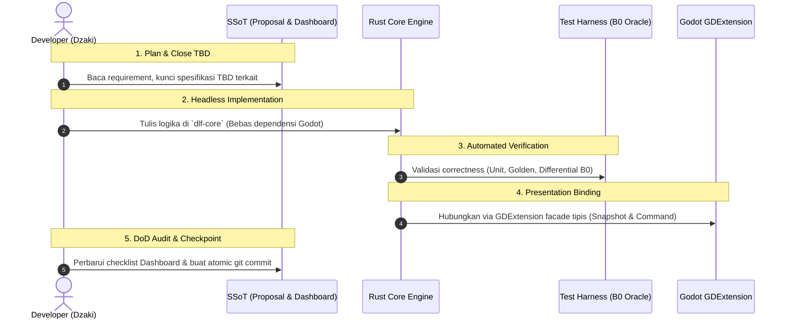
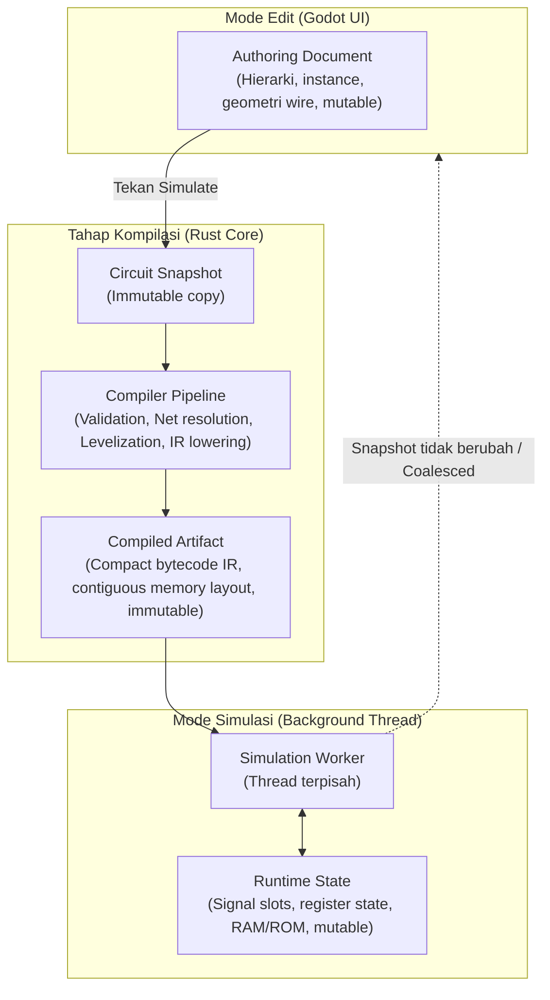

# Digital Logic Forge (DLF)

> **Simulator Rangkaian Logika Digital Visual dengan Compiled Execution untuk Komputer Buatan Pengguna**  
> *Tugas Akhir Berbasis Project — Program Studi Informatika, Universitas Negeri Padang (2026)*  
> Penulis: **Dzaki Sultan Rabbani** (NIM: 23343035)

---

## 📌 Status & Posisi Proyek Saat Ini

| Parameter | Keterangan |
| :--- | :--- |
| **Milestone Aktif** | **M1: Headless Circuit Model** 🚀 *(M0 Selesai & Terverifikasi)* |
| **Fokus Pekerjaan** | Skema dokumen rangkaian JSON, Stable ID 64-bit, structural validator |
| **Status Engine** | Baseline integrasi Rust Core + Godot 4.7.2 GDExtension terbukti 100% lulus |
| **Single Source of Truth** | [Proposal TA (Markdown)](docs/compiled%20circuit%20simulator.md) & [Progress Dashboard](docs/tracking/DASHBOARD.md) |

---

## 🔄 Visualisasi Alur Kerja (Development Workflow)

Proyek ini dibangun secara inkremental dan digerakkan oleh risiko (*risk-driven capability-based milestones*) mengikuti 7 prinsip rekayasa di Bab III proposal.

### 1. Peta Jalan 10 Milestone (M0 - M9)


### 2. Siklus Eksekusi 5 Tahap per Milestone (The 5-Step Loop)

Setiap tahapan milestone wajib melalui 5 tahapan berurutan sebelum dinyatakan selesai (*Definition of Done*):



---

## 🏛️ Arsitektur Tiga Representasi Data

DLF memisahkan secara ketat tiga representasi data agar eksekusi pada *hot loop* tidak terbebani struktur data editor visual:



---

## 📂 Struktur Repositori

```
digital-logic-forge/
├── AGENTS.md                  # Working contract & pedoman AI
├── README.md                  # Dokumentasi utama & visualisasi workflow
├── docs/
│   ├── compiled circuit simulator.md  # Naskah proposal (Markdown SSoT)
│   ├── compiled circuit simulator.pdf # Dokumen acuan asli
│   ├── tracking/              # Dashboard progres, status risk, & workload
│   ├── decisions/             # Architecture Decision Records (ADR)
│   └── specs/                 # Spesifikasi formal format file & IR
├── crates/
│   ├── dlf-core/              # Logika simulasi & kompilasi murni (Rust)
│   └── dlf-godot/             # GDExtension adapter tipis (Rust -> Godot)
├── app/
│   └── godot/                 # Proyek UI Godot 4.7.2
├── tests/
│   └── fixtures/              # Rangkaian uji & golden outputs
└── scripts/                   # Skrip otomasi PowerShell
```

---

## 🛠️ Standar & Disiplin Pengembangan

- **No Clever Code**: Kode harus jelas, ekspresif, dan mudah dipahami.
- **Wajib Code Docs**: Setiap fungsi publik, modul, dan tipe data wajib memiliki dokumentasi (`///` di Rust).
- **Correctness First**: Optimasi performa hanya dipertimbangkan setelah lulus uji kebenaran (*correctness suite*).
- **Elephant-Goldfish Model (EGM)**: Memori jangka panjang dipegang oleh Proposal, Dashboard, dan ADR (Elephant); eksekusi tugas mikro dan audit kualitas dijalankan oleh sub-task / subagent spesifik (Goldfish).
